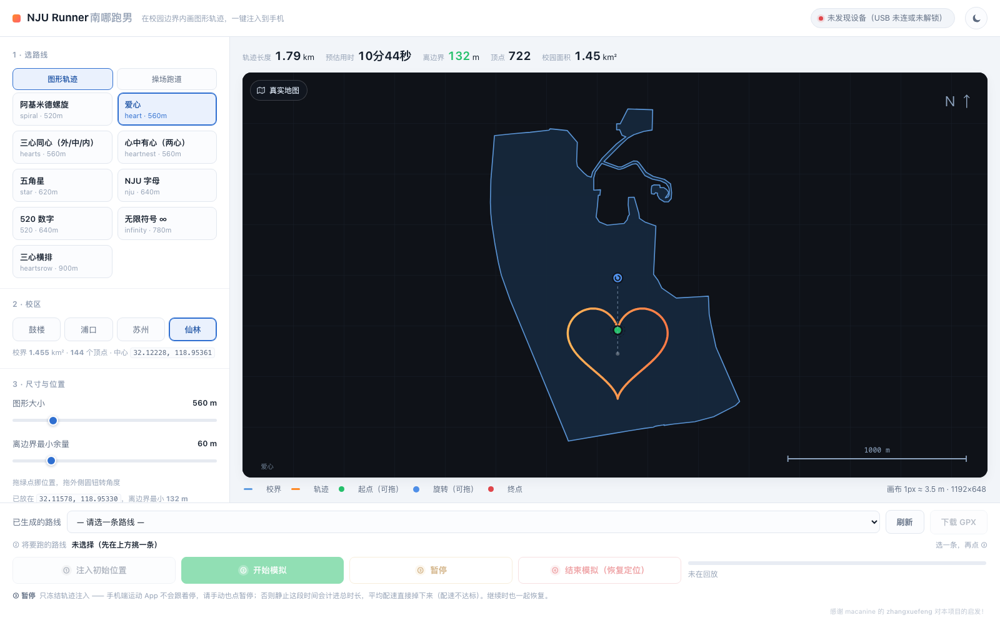
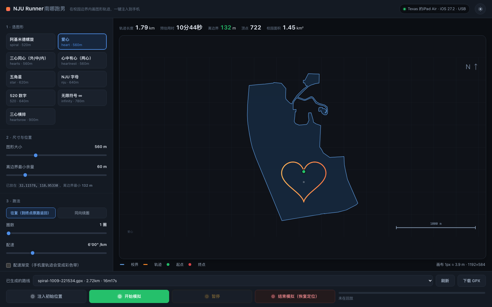

# NJU Runner · 南哪跑男

> 在校园边界内**画一个图形**（爱心 / 520 / 五角星 / 校名缩写…），自动摆到最安全的位置，
> 按你要的配速生成 GPX，再一键注入到 iPhone —— 手机地图上就出现一条「跑出这个形状」的轨迹。
>
> 也可以**沿真实操场跑道跑圈**：内置南大四个校区的真实跑道位置与朝向，每圈正好 400 m。
>
> 自动摆的位置不满意？**直接在预览图上拖** —— 拖起点平移、拖圆钮转角度，所见即所得。

**不用敲命令，也不用叫 AI。** 打开网页点几下就行。

<p align="center">
  
  
</p>

---

## 快速开始

```shell
git clone <this-repo> && cd nju-runner
python3 -m pip install -r requirements.txt
```

**macOS / Linux**

```shell
./start.sh              # 默认 http://127.0.0.1:8788
./start.sh 9000         # 换端口
```

或者直接**双击 `启动.command`** —— 会起服务并自动打开浏览器。用完 `Ctrl+C` 关掉。

`start.sh` 会自己找一个装着 numpy 的 Python；要用指定的解释器就
`NJURUNNER_PY=/path/to/python ./start.sh`。

**Windows**

```bat
start.bat               :: 默认 8788，自动开浏览器
start.bat 9000          :: 换端口
```

`start.bat` 会依次试 `py -3` / `python` / `python3`，挑第一个装了 numpy 的。
装依赖：

```bat
pip install numpy
pip install pymobiledevice3   :: 只有要推真机才需要
```

装完先自检一遍（不碰手机、不碰定位）：

```powershell
powershell -ExecutionPolicy Bypass -File tools\windows-selftest.ps1
```

### 平台支持

| 能力 | macOS / Linux | Windows |
|---|---|---|
| 画图 / 预览 / 生成 GPX / 下载 | ✅ | ✅ |
| 越界校验、配速斜坡、多圈往复 | ✅ | ✅ |
| 校区切换 / 操场跑道模式 | ✅ | ✅ |
| 真实地图（OSM 瓦片，走后端代理 + 本地缓存） | ✅ | ✅ |
| 真机注入（注入初始位置 / 开始模拟 / 暂停继续 / 结束模拟） | ✅ | ⚠️ 代码已适配，实机验证待补 |
| Windows 真机注入的额外前提 | — | Apple 移动设备驱动（iTunes / Apple 设备） |

Windows 上的差异点都已收口到 `core.py` 顶部那一小段平台层：

- **暂停 / 继续**：POSIX 用 `SIGSTOP` / `SIGCONT`；Windows 没有这两个信号
  （`signal.SIGSTOP` 属性都不存在，被 `except` 吞掉后会变成「按钮显示成功、进度照跑」的
  假成功），改走 `ntdll` 的 `NtSuspendProcess` / `NtResumeProcess`。
- **找子进程**：POSIX 用 `pgrep -P`；Windows 用 `wmic` → `PowerShell CIM` 逐级回退。
- **结束进程**：POSIX 发信号；Windows 用 `taskkill`。
- **后台起进程**：POSIX 用 `start_new_session`；Windows 用
  `DETACHED_PROCESS | CREATE_NEW_PROCESS_GROUP`（前者在 Windows 上会被静默忽略）。
- **执行 `vendor/` 里的脚本**：这些文件没有扩展名，Windows 的 `CreateProcess`
  直接执行会报 `WinError 193`，统一改成用当前解释器起。

装了 `psutil` 的话以上全部优先走 psutil（三平台语义一致），没装就走系统命令，都能用。

### 跑起来需要什么

| 依赖 | 说明 |
|---|---|
| Python 3.9+ | 起服务、算几何 |
| numpy | 落点搜索加速（`pip install -r requirements.txt`） |
| **psutil** | **可选但推荐**：进程树、挂起/恢复、结束进程三平台统一走它 |
| **pymobiledevice3** | **可选**：只有把轨迹推到真机才需要。没有它照样能画图、生成 GPX、下载 |
| iPhone / iPad | iOS 17+、**已开开发者模式**、数据线直连、解锁并信任本机 |

图形算法与配速工具（`gpxart` / `runroute`）**已内置在 `vendor/`**，clone 下来就能用，不必额外装。

---

## 界面怎么用

左边从上到下就是一条流水线，右边是实时预览。**章节序号会跟着当前模式重排** ——
操场模式下「尺寸与位置」整块隐藏，所以后面几节的编号会往前挪。

**1 · 选路线** — 先挑路线类型：

- **图形轨迹**：九个现成图形，点一下即选，尺寸自动填默认值。

  | | | |
  |---|---|---|
  | 爱心 `heart` | 三心同心 `hearts` | 心中有心 `heartnest` |
  | 三心横排 `heartsrow` | 五角星 `star` | 无限符号 `infinity` |
  | 阿基米德螺旋 `spiral` | NJU 字母 `nju` | 520 数字 `520` |

- **操场跑道**：直接沿真实跑道跑 N 圈，不做落点搜索 —— 跑道位置是固定的。
  详见下文「[操场跑道模式](#操场跑道模式)」。

**2 · 校区** — 鼓楼 / 仙林 / 浦口 / 苏州，点一下即切。下面的灰字会显示该校区校界的
面积、顶点数和中心坐标；操场模式下还会多出一个「跑道」下拉框，只列**这个校区**收录的跑道。
某个校区没收录跑道时会明确提示，切回「图形轨迹」即可照常用。

**3 · 尺寸与位置**（图形轨迹才有）— 拖动即改，右侧实时重画。

- *图形大小*：图形的**最长边**（米）。太大放不下会提示，调小即可。
- *离边界最小余量*：图形离校园边界至少留多少米。余量不够时程序会先试「**原地微调角度**」，
  只有实在放不下才允许倾斜（爱心歪着放很难看，所以正放永远优先）。
- **手动摆位** —— 预览图上**直接拖**：
  - 拖**起点那个绿圆点** = **整条轨迹平移**（不改变形状）；
  - 拖图形外侧那根虚线臂尽头的**蓝色圆钮** = **绕中心旋转**，像画图软件一样；
  - 拖动是纯前端的**刚体变换**，帧率级跟手、**不发后端请求**；松手后才回后端复核一次精确余量。
    转角度时按住 **Shift** 会吸附到 **15°** 的整数倍；
  - 不满意点底部的「**重置位置与角度**」回到自动算出的最优摆放。

  抓手刻意做得「丑」（虚线环 + 蓝色圆钮）就是为了让你知道**它在哪、能拖** ——
  不拖的时候整条轨迹和自动生成的一模一样。
- **越界会分级提醒**：图形越过校界 **≤1 km 给黄色警告**、**>1 km 给红色警告**，
  面板里「越界 xx」与地图左上角的提示条同色同步。**都只是提醒，照样能生成。**
- **放不下也能生成**：以前余量为负会直接报错，现在只给一条警告照生成 ——
  校界只是个参考，有人国庆回老家照样跑，那边压根没有「南大边界」。

**4 · 跑法**

- *往复*：跑到终点原路返回，图形重合、不糊。**默认推荐**。
- *同向绕圈*：每圈回到起点重新开始，会在图形外多出一条回程直线。（操场模式固定用这个。）
- *方向*（操场跑道才有）：**逆时针**（标准）或顺时针。田径场标准跑向是逆时针。
- *圈数*：图形太小时靠多跑几圈凑距离，比硬放大更安全（放大容易出界）。
- *配速*：整体配速。运动 App 里轨迹会按速度着色。
- *配速渐变*：起点慢、终点快（或反之）。**手机里的轨迹会变成一条彩色带**，比单色好看得多。
- *配速波动*：真实跑步不会匀速。默认 **±8%**，速度沿路做**平滑随机游走**
  （相邻采样点相关，不是逐点乱跳）—— 一段快、一段慢，连着变，看着才像真人；
  拉到 0 就是**完全匀速**（死板但好看）。
- *GPS 漂移*：定位本身的抖动幅度，默认 **2.5 m**。这是轨迹坐标上的平滑微扰
  （沿路缓慢漂、不是锯齿），跟你实际站的位置无关，只是让点列不像机器画的完美曲线。
  注意它是**真实位移**，程序会把漂移算进时间累加，所以**平均配速不会被带偏**。
  不需要就拉到 0。

**5 · 生成** — 补时间戳 + 逐点越界校验，生成到 `out/`。文件名留空自动命名。

**6 · 定位工具（可选）** — 手动指定经纬度，把手机定位钉到任意坐标。

底部第一行是**路线库**：选一条已生成的路线 → 刷新 / 下载 GPX。

底部第二行是**模拟控制台**，四个按钮从左到右就是一次完整模拟的生命周期：

| 按钮 | 做什么 | 备注 |
|---|---|---|
| **① 注入初始位置** | 把手机定位钉到所选路线的起点，并一直保持 | 位置会停在起点不动，直到你点 ④ |
| **② 开始模拟** | 按轨迹把点依次推给手机 | 会自动先做一次 ①，衔接无跳变 |
| **③ 暂停 / 继续** | 冻结 / 解冻注入进程（`SIGSTOP`↔`SIGCONT`，Windows 走 `NtSuspendProcess`） | 连计时一起冻住，**不丢进度**；再点变「继续」 |
| **④ 结束模拟（恢复定位）** | 停回放 + 释放定点 + 发 `clear` | 若手机仍停在旧位置，**拔一次数据线** |

> **③ 暂停必须和手机端一起暂停。** 网页上的「暂停」只冻住轨迹注入（手机不再移动），
> 但**手机里的运动 App 不会跟着停** —— 它照旧计时。静止那段时间会被算进总时长，
> 平均配速直接掉下来，配速就不达标了。所以：点「暂停」后，**去手机端也按一下暂停**；
> 点「继续」后再在手机端一起恢复。界面上的暂停键下方常驻这条提示，暂停时会高亮。

右侧进度条实时显示已推送到第几个点、已跑时长 / 预计时长。

两个细节：

- **起播会自动先把定位钉到轨迹起点**，再交接给回放 —— 否则设备当前位置与起点之间的瞬移
  会被运动 App 记成一条杂线。起播前请确认 App 没在记录。
- 如果你用命令行另起了回放，页面会显示「检测到命令行回放：xxx.gpx」，
  但它**不接管**那个会话（停止按钮对它无效，回命令行处理）。

### 操场跑道模式

「在操场跑几圈」是最常见的刷跑步数据方式，所以它被做成了一种**路线类型**，
而不是另一套独立的界面 —— 选了「操场跑道」，下面自然就出现该校区的跑道子选项。

已收录的跑道（位置与朝向都量自 OpenStreetMap 的真实场地，**不是随手放的**）：

| 校区 | 跑道 | OSM 来源 | 每圈 |
|---|---|---|---|
| 鼓楼 | 苏浙运动场 | `way/187816516`（`leisure=track`） + 场地外框 `way/88778929` | 400 m |
| 仙林 | 炜华体育场 | `way/99661837`（`sports_centre`） + 内场 `way/118862373` | 400 m |
| 仙林 | 第二运动场 | `way/609155597` + 内场 `way/609155596` | 400 m |
| 浦口 | 浦口校区运动场 | `way/89782131`（`leisure=pitch`，校区内最大场地） | 400 m |
| 苏州 | — | 校区内 OSM 上没有任何 leisure/sport 要素，暂未收录 | — |

**为什么不是直接沿 OSM 描的那圈跑？** 因为 OSM 上这些场地绝大多数只画了
**含看台的外框**（周长 490~600 m），沿它跑一圈，App 会记成 500 多米，
距离和配速全错。所以这里的做法是：

> **位置与朝向取自 OSM 的真实场地，跑道几何按 IAAF 标准 400 m 生成**
> —— 直道 84.39 m × 2 + 半径 36.80 m 的两个半圆 = 400.00 m（第 1 道测量线）。

即圆心 = 真实场地形心，直道方向 = 真实场地的最长直边方向。这样手机上记到的
每一圈正好 400 m，配速才是真配速。每块跑道的 `properties` 里都写清了
`source`（OSM way id）、`derived`（怎么推导的）和 `axis_deg`（长轴角度），可逐条复核。

复现与校验：

```shell
python3 tools/make-tracks.py                # 重新生成 data/tracks/*.geojson
python3 tools/verify-tracks.py              # 联网拉 OSM 真实场地，逐块比对
```

`verify-tracks.py` 会打印「场地周长 / 跑道周长 / 轴向差 / 形心间距」，
偏差超出容差（轴向 >5°、形心 >15 m、周长 ≠ 400±1 m）就以非 0 退出。
现有四块的实际偏差是**轴向 0.3°、形心 0.3~0.4 m**。

### 真实地图

地图区左上角有个**悬浮按钮**，在两种底图之间切：

| 底图 | 说明 |
|---|---|
| **极简**（默认） | 自绘网格，恒深色，不联网。只为看清轨迹形状，最省事也最快。 |
| **真实地图** | OSM 瓦片，能直接看到自己的跑道画在了哪栋楼旁边。 |

切换按钮上写的是「点它会去哪」（当前是真实地图时显示「极简底图」），选择记在
`localStorage`。瓦片由**本地后端代理抓取并缓存**在 `data/tilecache/`，理由有两个：
国内直连 `tile.openstreetmap.org` 的 TLS 时通时断，而且浏览器直连会暴露来源。
后端先直连、失败再依次走本机代理（`NJU_TILE_PROXY` → 环境变量 → `7890/1087/6152`）。
瓦片实在取不到时会自动退回极简底图，并在角落说明原因。

> 真实地图的数据来自 **© [OpenStreetMap](https://www.openstreetmap.org/copyright) 贡献者**，
> 按 [ODbL](https://opendatacommons.org/licenses/odbl/) 许可使用。界面右下角常驻署名，
> 只在真实地图模式下显示 —— 转发/再发布时请一并保留。

### 深色模式

右上角的按钮切换浅色 / 深色，选择记在 `localStorage`；从没切过就跟随系统
`prefers-color-scheme`。中间那块画布**始终是深色** —— 它是「出图区」，不跟着主题翻。

---

## 它比「写死的路线」强在哪

| | 固定路线 JSON | NJU Runner |
|---|---|---|
| 路线来源 | 事先手工画好 | 参数化图形，随时改 |
| 换尺寸 | 得重画 | 拖滑块 |
| 摆位 | 靠眼估 | 自动搜索边界内最安全的落点，**也能在图上手动拖 / 转** |
| 越界 | 跑出去才知道 | 生成前逐点校验并报最小余量；越界 ≤1 km 黄、>1 km 红 |
| 变速 | 不支持 | 配速斜坡 → 彩色轨迹 |
| 真假度 | — | 配速波动 + GPS 漂移，点列不像机器画的 |

落点搜的是「到边界距离最大的一批候选中心」再逐个试摆放。原版是纯 Python，
用 numpy 重写并做两级搜索（抽稀点粗筛候选 → 前几名再用全点精算）后，
九个图形全部与原算法**逐位一致**（中心误差 0.0000 m），速度快 8~25 倍。
`core.selftest()` 可随时复验。

---

## ⚠️ 三件必须知道的事

1. **回放跑到一半别掐，也别拔线。** 强行中断会让模拟位置残留在设备侧，
   之后 `clear` 也清不掉（这条指令没有回执，退出码恒为 0，不能当判据）。
   要停就用界面上的「暂停」或「结束模拟」。
2. **收尾以「拔一次数据线」为准。** 跑完或停止后程序会自动发 clear，
   但如果手机地图还停在原地，拔线是唯一 100% 可靠的恢复方式
   （或用 `pymobiledevice3 diagnostics restart` 重启设备）。
3. **注入期间手机得连着线、保持解锁。** iOS 只认 USB 连接的开发者会话。

### 能力边界

注入的**只有经纬度**，没有海拔、速度、步数、加速度、陀螺仪。
如果目标 App 用步频做防作弊，这条路会被识别 —— 这是工具的能力边界，不是 bug。

---

## 文件结构

```
nju-runner/
├── 启动.command        双击启动（macOS）
├── start.sh            命令行启动（macOS / Linux，自动找带 numpy 的 Python）
├── start.bat           双击启动（Windows）
├── server.py           本地 HTTP 服务 + REST API（纯标准库，含 OSM 瓦片代理）
├── core.py             核心：加载 vendor 工具、numpy 落点搜索、平台层、设备与回放控制
├── static/             前端单页（无 CDN 依赖，离线可用）
│   ├── index.html · app.js · style.css
├── vendor/             内置的 gpxart / runroute（上游在 ~/.local/bin）
├── tools/
│   ├── make-tracks.py      按 OSM 真实场地生成操场跑道 GeoJSON
│   ├── verify-tracks.py    拿 OSM 真实场地复核跑道是否贴合（可联网 / 用本地响应）
│   ├── sync-vendor.py      从上游同步 vendor/（跨平台，替换失配会报错）
│   ├── sync-vendor.sh      上面那个的 zsh 壳
│   ├── selftest.py         跨平台自检（环境 / 几何 / 平台原语 / 服务端到端）
│   └── windows-selftest.ps1  Windows 一键跑自检
├── data/boundaries/    校区边界 GeoJSON（可自行添加）
├── data/tracks/        操场跑道 GeoJSON（圆心与朝向量自 OSM 真实场地）
├── data/tilecache/     真实地图瓦片缓存（不入库）
├── docs/               截图
└── out/                生成的 GPX 与回放日志（不入库）
```

### 关于 `vendor/`

`gpxart`（图形与落点）和 `runroute`（配速与时间戳）是两条独立命令行工具，
为了让仓库自包含，这里内置了一份。加载顺序是
**环境变量 `GPXART_PATH` / `RUNROUTE_PATH` → `vendor/` → `~/.local/bin/`**。

内置副本相对上游改了三处：

1. shebang → `#!/usr/bin/env python3`；
2. `gpxart` 里改成优先找同目录的 `runroute`；
3. `runroute` 里的 `pymobiledevice3` 路径不再是写死的绝对路径，而是
   **环境变量 `PMD` / `PYMOBILEDEVICE3` → `PATH` → 常见安装位置**。

第 3 条是必需的：写死路径意味着别人 clone 下来点「开始模拟」会直接报
「找不到 pymobiledevice3」，而 `clear` 会静默变成空操作。

上游更新后同步：

```shell
./tools/sync-vendor.sh                            # macOS / Linux
python tools\sync-vendor.py                       # Windows
GPXART_SRC=/path/to/bin python tools/sync-vendor.py   # 换上游目录
```

同步脚本用的是**带断言的字面替换**：上游改了措辞、锚点找不到时会直接报错退出，
而不是静默产出一份坏的副本。跑完还会横扫一遍，确认没有本机路径泄漏进仓库。

---

## API（想自己接别的界面也行）

| 方法 | 路径 | 作用 |
|---|---|---|
| GET | `/api/shapes` | 图形列表 |
| GET | `/api/boundaries` | 可用边界（含 `label` / `campus` / 面积 / 中心） |
| GET | `/api/tracks` | 操场跑道列表（含 `campus` / 每圈长度 / 顶点数 / OSM 来源） |
| GET | `/api/tile?z=&x=&y=` | OSM 瓦片代理（抓取 + 磁盘缓存；取不到回 404，让前端自己降级） |
| POST | `/api/preview` | `{shape,size,margin,boundary}`；或 `{track,direction}` → 几何 + 余量 + 点列 |
| POST | `/api/eval` | `{points,boundary,margin}` → 给一串点列算余量（前端拖完复核用，**不落盘**） |
| POST | `/api/generate` | 同上 + `{pace,laps,laps_mode,pace_ramp,jitter,pace_noise,points,out_name}` → 生成 GPX |
| POST | `/api/check` | 对已有 GPX 做逐点越界校验 |
| GET | `/api/routes` | `out/` 里的路线列表 |
| GET | `/api/device` | 设备连接状态 |
| POST | `/api/prime` | ① 注入初始位置：`{file}` 钉到该路线起点，或 `{lat,lon}` 钉到任意坐标 |
| POST | `/api/play` `{file}` | ② 开始模拟 |
| POST | `/api/pause` / `/api/resume` | ③ 暂停 / 继续 |
| POST | `/api/release` | ④ 结束模拟（停回放 + 释放定点 + clear） |
| POST | `/api/stop` | 仅停回放（不管定点） |
| GET | `/api/status` | 回放进度（含 `paused` / `holder` / `external`） |
| GET | `/api/download?file=` | 下载 GPX |

配速字段 `pace` / `pace_ramp` 三种写法都收：`6:00`、`6'00"`（界面发的就是这种）、
纯秒数 `360`。归一化在 `core.py` 的 `_norm_pace()` 里做，不去改 `vendor/` ——
免得 `tools/sync-vendor.py` 重同步时把补丁冲掉。

几个和「摆位 / 真实度」相关的字段：

- **`points`**（`/api/generate` 专用）：传一串 `[lat,lon]` 点列，就**跳过自动落点搜索、
  直接按你给的点出 GPX** —— 前端手动拖完位置/角度后就是靠它做到「所见即所得」。
  不给则照常自动搜索最优落点。
- **余量分级**：所有带余量的返回（`/api/preview`、`/api/eval`、`/api/generate`）统一附上
  `margin_m`（到边界最短距离，负值=越界）、`over_m`（越界多少米，界内为 0）、
  `level`（`ok` / `warn` ≤1 km / `danger` >1 km）、`ok`（布尔）、`note`（现成文案，界内正常时为 `null`）。
  前端只是把 `level` 直接映射成颜色，阈值定义在 `core.py` 的 `BOUND_WARN_M = 1000.0`。
- **`jitter` / `pace_noise`**：GPS 漂移（米，默认 2.5）与配速波动比例（默认 `0.08` = ±8%），
  直接透传给 `vendor/runroute` 的同名参数。

### 暂停是怎么做到的

回放链路是 `runroute play` → `pymobiledevice3 developer dvt simulate-location play`，
后者是个「按相邻点时间差 sleep，然后 set」的循环。

暂停 = 把**注入进程**冻住 —— 连 sleep 计时一起冻。
继续 = 解冻。所以进度、计时都不丢，也不会在设备侧留下残留
（对比之下，直接 kill 就会残留，只能拔线）。

冻住的办法按平台分：POSIX 是 `SIGSTOP` / `SIGCONT`；Windows 没有这两个信号，
走 `ntdll.NtSuspendProcess` / `NtResumeProcess`（需要 `PROCESS_SUSPEND_RESUME` 权限的句柄）。
装了 psutil 则两边都优先用 `psutil.Process.suspend()/resume()`。

服务退出时会先解冻再杀，避免留下一个冻结的僵尸进程。

---

## 换一个校园

把目标区域的边界 GeoJSON（WGS-84）丢进 `data/boundaries/`，刷新页面即可选用。

**校区归类靠文件名 + `properties`**：文件名像 `boundary-<学校>-<校区>.geojson`，
或直接在 `properties` 里写 `{"campus": "gulou", "label": "鼓楼", "name": "南京大学(鼓楼校区)"}`。
`campus` 相同的边界会归到同一个校区按钮下，`label` 是按钮上显示的名字。
没写 `campus` 的边界会照常出现在列表里，只是不参与校区分组。

操场跑道同理：把 GeoJSON 丢进 `data/tracks/`，`properties` 里写上
`{"name": "...", "campus": "gulou", "source": "OpenStreetMap way/...", "derived": "..."}`，
它就会出现在对应校区的「跑道」下拉框里。`LineString` 和 `Polygon` 都认，
会按你给的坐标原样跑 —— 所以请给**第 1 道测量线**的几何（400 m），
而不是含看台的场地外框，否则每圈会被记成 500 多米。生成现有四块的推导见
[tools/make-tracks.py](tools/make-tracks.py)，校验见 [tools/verify-tracks.py](tools/verify-tracks.py)。

> 注意坐标系：本工具全程用 **WGS-84**（GPS / iOS 注入口径）。
> 高德、腾讯、百度用的是 **GCJ-02**，同一地点两者能差四五百米 ——
> 拿高德上的点去对轨迹，一定会觉得"偏了"。

## 路线图 / 待办

已经能用的都在上面了，下面这些是**想做但还没做**的，按优先级大致排：

- **地图自由拖动与缩放**：现在底图跟着图形自动取景，不能手动挪/缩。
  目标是加一层地图平移 + 滚轮缩放（拖轨迹的抓手已经做好了，思路可以复用）。
- **自定义路线（画笔）**：不用现成图形，直接在图上手绘一条线当轨迹。
- **自由区域**：鼓楼校区现在只收录了北园那一块（0.44 km²），**南园是另一块独立多边形**，
  单环边界装不下 —— 要靠「自由区域」把两个环都兜进来才能覆盖整个鼓楼校区。
- **Windows 真机实测**：注入链路的 Windows 分支（`NtSuspendProcess` 等）代码已适配、
  自检脚本也备好，但还没在真机 + iPhone 上完整跑通一遍。

已知但暂不处理的小问题：`server.py` 退出时（`atexit`）会**无条件**下发一次 `clear`，
哪怕这个会话根本没起过模拟。`clear` 没有回执、退出码恒 0，所以这属于"多说不碍事"，
先记在这里。

## 致谢

- 这个页面的起点是同学的项目 **[macanine/zhangxuefeng](https://github.com/macanine/zhangxuefeng)**
  （Python + Flask + Leaflet，一条写死的 `zjg.json` 路线）——
  「打开网页点几下就能跑出个图形」这个念头是从那儿来的。**感谢 macanine 的 zhangxuefeng 对本项目的启发！**
- 操场跑道的位置与朝向、校区边界轮廓：**[OpenStreetMap](https://www.openstreetmap.org/copyright) 贡献者**（ODbL）。
- 几何与回放内核：本仓库 `vendor/` 下的 `gpxart` / `runroute`（MIT）。

## 许可

MIT，见 [LICENSE](LICENSE)。其中由 OpenStreetMap 派生出的数据
（`data/boundaries/`、`data/tracks/`）随 ODbL，署名要求见上文。
